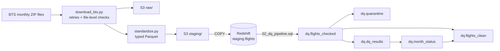

# U.S. Flight Operations Data Pipeline (AWS)

An end-to-end ELT pipeline for 12 months of U.S. Department of Transportation flight data (7,049,869 flights), built on Amazon S3 and Redshift Serverless, with a SQL data-quality layer that flags, quarantines, and gates data by month before it reaches analytics.

## Architecture



**Why ELT:** Python only moves and types the data. All row-level quality rules run as SQL inside Redshift, where they are visible, testable, and re-runnable against the full history.

## Data

- **Source:** [BTS Reporting Carrier On-Time Performance](https://www.transtats.bts.gov/), one ZIP file per month
- **Range:** September 2025 to August 2026, 12 files, 7,049,869 rows
- **Grain:** one row per scheduled flight leg (cancelled and diverted flights included)

## Pipeline

### 1. Ingestion (Python, `ingestion/download_bts.py`)
- Downloads each month with up to 5 retries and exponential backoff, verifies byte counts, and records a manifest (row count, SHA-256, dates covered)
- **File-level validation**, which stops a month from loading:
  - schema matches the expected 110 columns
  - the file contains only the requested month
  - every calendar day is present
- **Volume check** (warning only): flights per day compared with the leave-one-out median of the other months, ±20%. Observed normal range was −10.6% to +4.3%.
- Raw files stored in S3 (`raw/year=YYYY/month=MM/`) so any month can be reprocessed from source
- `tests/test_rules.py`: 11 checks using deliberately broken copies of a real file

### 2. Standardization (Python, `etl/Standardize.py`)
- Selects 49 columns with explicit types (times kept as text to preserve leading zeros) and adds a `source_file` lineage column
- Writes partitioned Parquet, about 15x smaller than the CSV (15–19 MB vs ~265 MB per month)
- Checks the row count against the manifest before uploading to S3

### 3. Load (SQL, `sql/01_staging.sql`)
- `COPY` from S3 Parquet into `staging.flights`; row counts reconcile exactly with the manifest for all 12 months

### 4. Data quality (SQL, `sql/02_dq_pipeline.sql`)
Eight rules, each tested on hand-made cases before running on real data:

| Rule | Checks | Action | Batch threshold |
|---|---|---|---|
| DQ-1 | Scheduled time is valid `hhmm` (`2400` = next-day midnight); builds scheduled and actual departure timestamps | Fix; quarantine invalid | FAIL > 0.1% |
| DQ-2 | Cancelled flight with a departure time | Flag | WARN > 0.7% |
| DQ-3 | Delays and taxi-out above the month's 99.5th percentile / negative delay causes | Flag / quarantine | – / WARN > 0.5%, FAIL > 0.7% |
| DQ-4 | Required fields (identity and status; delays for completed flights) | Quarantine | FAIL > 0.5% |
| DQ-5 | Missing tail number, split by cancelled vs. not cancelled | Flag | WARN > 0 / > 20% |
| DQ-6 | Cancelled without a code / code on a non-cancelled flight | Flag / quarantine | – / FAIL > 0.1% |
| DQ-7 | Duplicate flights (exact copies / conflicting values) | Drop / quarantine | FAIL > 0.01% |
| DQ-8 | Delay causes sum to arrival delay (unattributed / mismatched) | Flag / quarantine | WARN > 0.5% / FAIL > 0.1% of delayed flights |

**Outputs:**
- `dq.flights_checked`: every row, with flags and a `quarantine_reason` listing every rule it failed
- `dq.quarantine`: an audit snapshot of the quarantined rows
- `dq.dq_results`: one row per month × rule, with violations, denominator, rate, thresholds, and status
- `dq.month_status`: any FAIL blocks the whole month; WARN does not
- `dq.flights_clean`: the input for the analytics layer

`sql/03_dq_checks.sql` verifies every run with 6 invariants (row reconciliation, no NULL flags, consistent outputs) and 14 regression checks. All 20 pass.

## Results (Sep 2025 – Aug 2026)

| | Rows |
|---|---|
| Loaded | 7,049,869 |
| Quarantined | 2 |
| Duplicates dropped | 0 |
| **Passed to analytics** | **7,049,867** |
| Months failed / warned | 0 / 1 |

## Findings

- **Midnight crossings:** in December 2025, 4,106 flights departed on a later date than scheduled. Combining the flight date with the actual departure time would have placed them almost a day early, so actual departure is derived from the schedule plus the delay.
- **Unattributed delays:** 147 delayed flights, all Southwest, reported long arrival delays with every delay cause set to zero. Normalized, this is under 0.1% of the carrier's delayed flights per month. These rows are flagged rather than quarantined, because removing them would drop some of the longest real delays and make on-time performance look better than it was.
- **February 2026 warning:** 21.5% of cancelled flights had no tail number, against a 20% threshold. February 22–24 accounted for 87% of these, matching a Northeast blizzard during which airlines cancelled flights a day ahead, before aircraft were assigned. The rest of the month was 8.6%. The threshold was left unchanged. ([`sql/analysis/dq5_feb2026_warn.sql`](sql/analysis/dq5_feb2026_warn.sql))
- **Delay causes:** in December 2025, late-arriving aircraft accounted for 41% of attributed delay minutes, the largest single cause. It reflects delays carried over from an aircraft's earlier flights rather than a root cause.

## Design decisions

- **Flag when information is missing; quarantine when it is contradictory.** A flagged row stays in every metric that doesn't depend on the flagged field.
- **Denominators follow the driver.** Missing tail numbers on cancelled flights are measured against cancelled flights, and cause mismatches against delayed flights, so seasonal swings in cancellations or delays don't trigger false warnings.
- **Thresholds catch changes in the data, not bugs in the rules.** A rule with a logic error produces a stable, plausible rate every month, so every rule was also tested on hand-made rows with known answers.
- **Relative thresholds have a blind spot.** A 99.5th-percentile cutoff always flags about 0.5% of rows, so it can't detect a shift in the whole distribution, such as a change of units.

## Repository structure

```
ingestion/
  download_bts.py          download, file-level validation, manifest, S3 upload
  expected_columns.json    schema baseline for validation
etl/
  standardize.py           typed Parquet + lineage column, S3 upload
tests/
  test_rules.py            tests for the file-level validation rules
sql/
  01_staging.sql           staging table, COPY, load checks
  02_dq_pipeline.sql       data-quality pipeline (re-runnable)
  03_dq_checks.sql         invariant and regression checks
  analysis/                investigations behind the findings above
requirements.txt
```

## How to run

Prerequisites: an AWS account, an S3 bucket, a Redshift Serverless workgroup whose default IAM role can read the bucket, and the AWS CLI signed in.

```bash
pip install -r requirements.txt

# 1. download, validate, and upload raw files
python ingestion/download_bts.py --start 2025-09 --end 2026-08 --s3-bucket <your-bucket>

# 2. test the file-level rules against one real month
python tests/test_rules.py data/raw/bts_ontime_2025_12.zip

# 3. write typed Parquet and upload to staging/
python etl/standardize.py --s3-bucket <your-bucket>
```

Then, in Redshift Query Editor v2, run `sql/01_staging.sql` (set your bucket name), `sql/02_dq_pipeline.sql`, and `sql/03_dq_checks.sql`.

## Next steps

- Star schema in an `analytics` schema: flight-leg fact table; date, airline, and airport dimensions (airport as a slowly changing dimension); incremental monthly loads
- Metric dictionary and a weekly business review (WBR) query
- Delay propagation analysis: chaining each aircraft's flights by tail number to find where delays start
- Dashboard
